

  

  <a href="https://portfolio-lemon-two-47.vercel.app/"></a>
  <a href="https://www.linkedin.com/in/thisul/"></a>
  <a href="https://kaggle.com/thisulherath"></a>
  <a href="mailto:thisulh@gmail.com"></a>


I started with **Java** and found my curiosity in **Python**. Now I connect the pieces: a dataset worth questioning, a model worth testing, and an interface that makes the result useful.

 


<a href="https://github.com/ThisulHerath/Telco-Customer-Churn-ML"></a>

<a href="https://github.com/ThisulHerath/UNI-VAULT"></a>

<a href="https://github.com/ThisulHerath/ShareBite-LK"></a>

<a href="https://github.com/ThisulHerath?tab=repositories">Explore all repositories →</a>

 


 


 


  
Contribution orbit · watch the trail

   
  <picture>
    <source media="(prefers-color-scheme: dark)" srcset="https://raw.githubusercontent.com/ThisulHerath/ThisulHerath/output/github-contribution-grid-snake-dark.svg" />
    
  </picture>

 


  
  
  
  <a href="https://www.instagram.com/_thisul_herath"></a>

Designed for curiosity. Built for the next orbit.

