

  <picture><source media="(prefers-color-scheme: light)" srcset="./assets/orbital/00-arrival-day.svg" /></picture>

<picture><source media="(prefers-color-scheme: light)" srcset="./assets/orbital/00-winter-transmission-day.svg" /></picture>

  <a href="https://portfolio-lemon-two-47.vercel.app/"><picture><source media="(prefers-color-scheme: light)" srcset="./assets/orbital/link-portfolio-day.svg" /></picture></a>
  <a href="https://www.linkedin.com/in/thisul/"><picture><source media="(prefers-color-scheme: light)" srcset="./assets/orbital/link-linkedin-day.svg" /></picture></a>
  <a href="https://kaggle.com/thisulherath"><picture><source media="(prefers-color-scheme: light)" srcset="./assets/orbital/link-kaggle-day.svg" /></picture></a>
  <a href="mailto:thisulh@gmail.com"><picture><source media="(prefers-color-scheme: light)" srcset="./assets/orbital/link-email-day.svg" /></picture></a>

<picture><source media="(prefers-color-scheme: light)" srcset="./assets/orbital/01-flight-deck-day.svg" /></picture>

I started with **Java** and found my curiosity in **Python**. Now I connect the pieces: a dataset worth questioning, a model worth testing, and an interface that makes the result useful.

 

<picture><source media="(prefers-color-scheme: light)" srcset="./assets/orbital/02-missions-day.svg" /></picture>

<a href="https://github.com/ThisulHerath/Telco-Customer-Churn-ML"><picture><source media="(prefers-color-scheme: light)" srcset="./assets/orbital/02a-churn-day.svg" /></picture></a>

<a href="https://github.com/ThisulHerath/UNI-VAULT"><picture><source media="(prefers-color-scheme: light)" srcset="./assets/orbital/02b-univault-day.svg" /></picture></a>

<a href="https://github.com/ThisulHerath/ShareBite-LK"><picture><source media="(prefers-color-scheme: light)" srcset="./assets/orbital/02c-sharebite-day.svg" /></picture></a>

<a href="https://github.com/ThisulHerath?tab=repositories">Explore all repositories →</a>

 

<picture><source media="(prefers-color-scheme: light)" srcset="./assets/orbital/03-equipment-day.svg" /></picture>

 

<picture><source media="(prefers-color-scheme: light)" srcset="./assets/orbital/04-flight-path-day.svg" /></picture>

 

<picture><source media="(prefers-color-scheme: light)" srcset="./assets/orbital/05-telemetry-day.svg" /></picture>

  
Contribution orbit · watch the trail

   
  <picture>
    <source media="(prefers-color-scheme: dark)" srcset="https://raw.githubusercontent.com/ThisulHerath/ThisulHerath/output/github-contribution-grid-snake-dark.svg" />
    
  </picture>

 

<picture><source media="(prefers-color-scheme: light)" srcset="./assets/orbital/06-contact-day.svg" /></picture>

  <a href="https://www.linkedin.com/in/thisul/"><picture><source media="(prefers-color-scheme: light)" srcset="./assets/orbital/link-linkedin-day.svg" /></picture></a>
  <a href="mailto:thisulh@gmail.com"><picture><source media="(prefers-color-scheme: light)" srcset="./assets/orbital/link-email-day.svg" /></picture></a>
  <a href="https://portfolio-lemon-two-47.vercel.app/"><picture><source media="(prefers-color-scheme: light)" srcset="./assets/orbital/link-portfolio-day.svg" /></picture></a>
  <a href="https://www.instagram.com/_thisul_herath"><picture><source media="(prefers-color-scheme: light)" srcset="./assets/orbital/link-instagram-day.svg" /></picture></a>

❄️ A little snow. A little Christmas magic. Still building for the next orbit. 🎄

